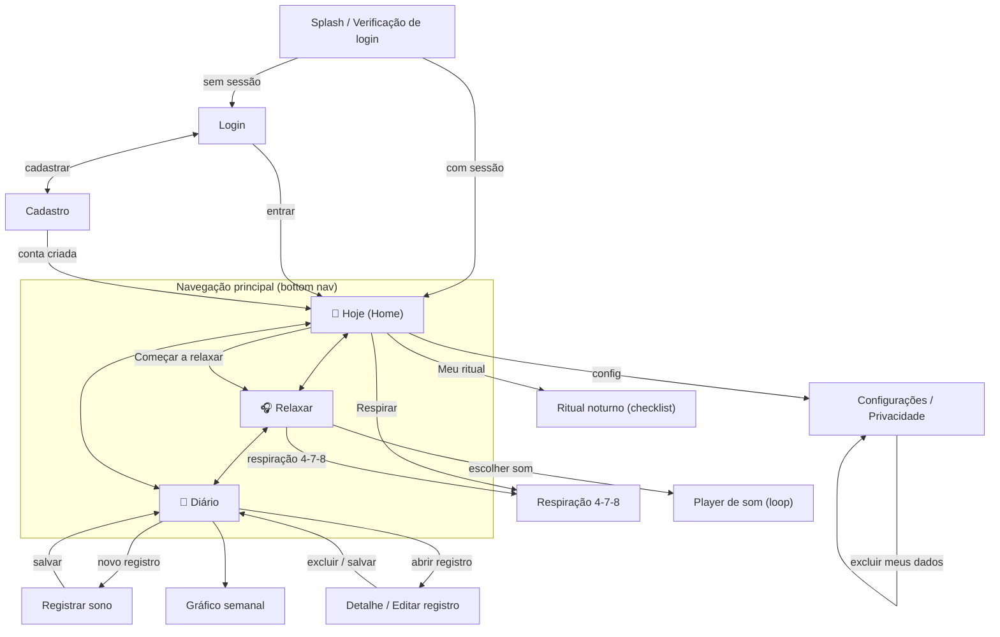
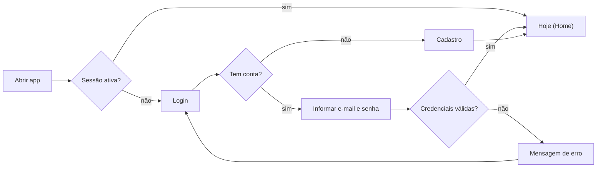
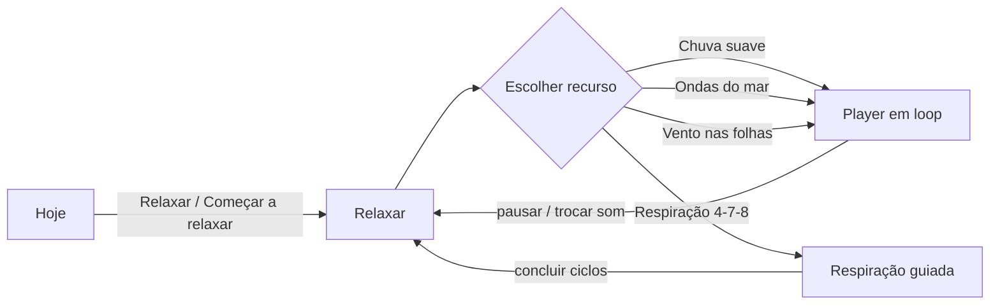
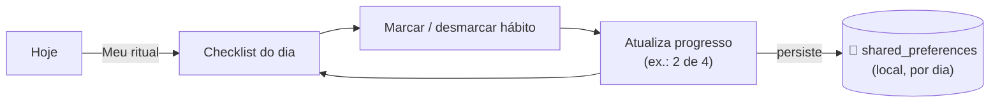
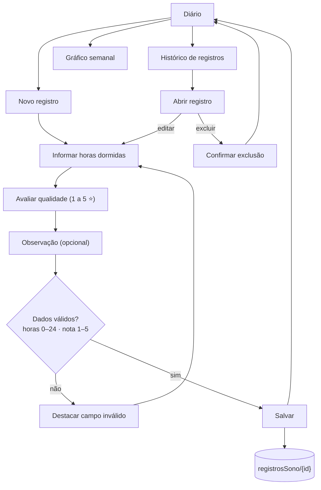

# Fluxos de Navegação — SonoLeve

> Unidade II · Item **b.v)** — Fluxo de navegação real do aplicativo (como as telas se
> conectam na prática). Fiel aos protótipos de alta fidelidade da Unidade I.

A navegação do SonoLeve é baseada em uma **barra inferior fixa** com três destinos —
**Hoje**, **Relaxar** e **Diário** — a partir dos quais se abrem as telas de detalhe.
O desenho respeita a regra dos **três toques** (RNF01): qualquer função principal fica a,
no máximo, 3 interações da abertura do app.

---

## 1. Mapa geral de telas

---

## 2. Fluxo de autenticação

Atende à exigência de Autenticação de Usuários (Firebase Auth).

**Tratamento de falhas (item a.iv do projeto):** credenciais inválidas, e-mail já em uso,
senha fraca e ausência de conexão devem exibir mensagens claras, sem travar a tela.

---

## 3. Fluxo de relaxamento

Protótipo "Encontre o seu silêncio". Atende F03/F02 e o requisito offline (RNF04).
Em **3 toques**: abrir app → Relaxar → escolher som.

---

## 4. Fluxo do ritual noturno (checklist)

Protótipo "Seu ritual, no seu tempo". Atende F01, RF01/RF02. O progresso é gravado
**localmente no dispositivo** (`shared_preferences`), sem passar pelo Firestore.

---

## 5. Fluxo de registro do sono (CRUD)

Protótipo "Registro do sono": Registrar noite → Informar horas → Avaliar descanso.
Atende RF06–RF11.

---

## 6. Regra dos três toques (RNF01)

| Função principal | Caminho | Toques |
|---|---|---|
| Ouvir um som | Abrir → Relaxar → escolher som | 3 |
| Respiração 4-7-8 | Abrir → Relaxar → Respiração (ou Hoje → Respirar) | 2–3 |
| Marcar hábito | Abrir → Meu ritual → marcar | 3 |
| Registrar sono | Abrir → Diário → Novo registro | 3 |
| Ver histórico | Abrir → Diário | 2 |

---

## 7. Telas do aplicativo (resumo)

| Tela | Origem (protótipo) | Funcionalidades |
|---|---|---|
| Login / Cadastro | — | Autenticação (Firebase Auth) |
| **Hoje** (Home) | "O dia pode ficar lá fora" | Atalhos: Meu ritual, Relaxar, Respirar + bottom nav |
| **Relaxar** | "Encontre o seu silêncio" | Lista de sons + respiração 4-7-8 (F02, F03) |
| Player de som | — | Reprodução em loop, offline (F03) |
| Respiração 4-7-8 | — | Exercício guiado (F02) |
| **Ritual noturno** | "Seu ritual, no seu tempo" | Checklist de hábitos, progresso local (F01) |
| **Diário** | "Registro do sono" | Histórico, novo registro, gráfico (F04–F06) |
| Registrar / Editar | — | CRUD de RegistroSono (RF06–RF10) |
| Gráfico semanal | — | Acompanhamento semanal (RF11) |
| Configurações | — | Tema, privacidade, excluir dados (RF13, RNF09) |

---

### Documentos relacionados
- `arquitetura.md` — camadas e integração Firebase
- `modelo-dominio.md` — entidades envolvidas em cada fluxo
- `modelagem-banco-dados.md` — onde cada fluxo grava (Firestore ou local)
