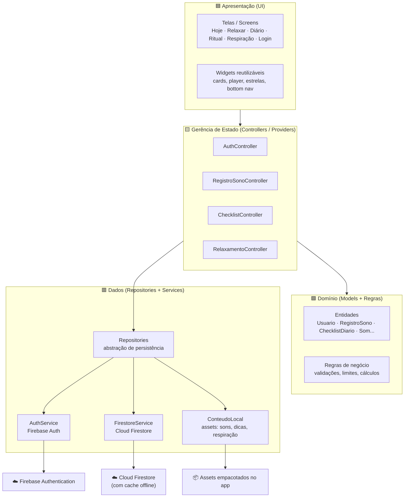
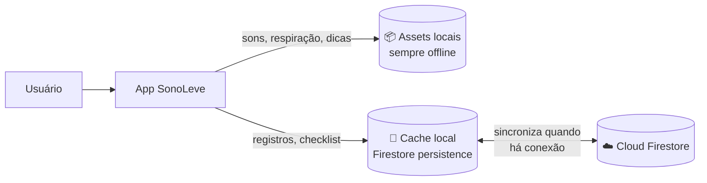
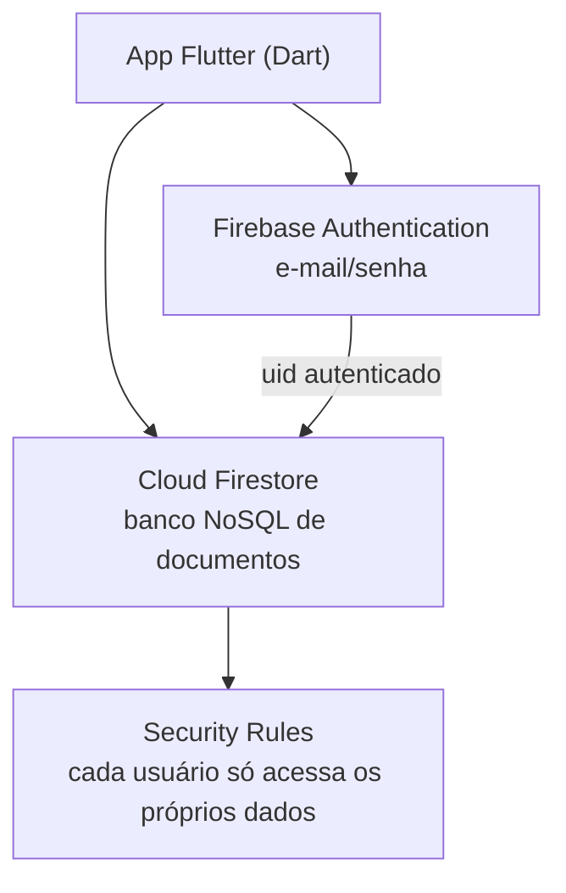

# Arquitetura Geral — SonoLeve

> Documento técnico da **Unidade II** · Item **b)** · Disciplina Programação para Dispositivos Móveis
> Stack obrigatória: **Dart + Flutter + Firebase (Authentication + Cloud Firestore)**

Este documento descreve a arquitetura geral do aplicativo **SonoLeve**, um assistente
noturno para higiene do sono e relaxamento. A arquitetura foi desenhada para atender
diretamente aos requisitos não funcionais do projeto, com destaque para o funcionamento
**offline-first** (RNF04, RNF07), o **baixo consumo de recursos** (RNF05, RNF10, RNF12)
e a **privacidade dos dados** (RNF08, RNF09).

---

## 1. Visão em camadas

O SonoLeve adota uma arquitetura em camadas (inspirada em *Clean Architecture* /
*layered architecture*), separando a interface, as regras de negócio e o acesso a dados.
Essa separação facilita os testes, a manutenção e o mapeamento do código para as entregas
acadêmicas (modelo de domínio, CRUDs e modelagem do banco).



| Camada | Responsabilidade | Exemplos |
|---|---|---|
| **Apresentação** | Renderizar telas e capturar interações. Não contém regra de negócio. | `HojeScreen`, `DiarioScreen`, `RelaxarScreen`, widgets |
| **Gerência de estado** | Orquestrar casos de uso, manter o estado da tela, chamar repositories. | `RegistroSonoController`, `ChecklistController` |
| **Domínio** | Entidades, validações e regras de negócio independentes de framework. | `RegistroSono.valido()`, `ChecklistDiario.progresso()` |
| **Dados** | Persistir e recuperar dados; isolar Firebase e assets locais. | `RegistroSonoRepository`, `AuthService`, `FirestoreService` |

**Princípio-chave:** a camada de Apresentação **nunca** fala diretamente com o Firebase.
Toda persistência passa por um *repository*, o que permite trocar a fonte de dados (ex.:
Firestore ↔ cache local) sem alterar as telas.

---

## 2. Estratégia offline-first

Os requisitos RNF04 e RNF07 exigem que relaxamento e registros funcionem sem internet.
A estratégia combina **conteúdo empacotado** e **persistência offline do Firestore**:



- **Conteúdo estático offline (RNF04/RNF12):** sons da natureza (chuva, ondas, vento),
  os parâmetros da respiração 4-7-8 e as dicas de higiene do sono são **empacotados como
  assets** no aplicativo. Não dependem de rede nem do banco — ficam disponíveis inclusive
  em modo avião. Os áudios devem ser compactados e preparados para *loop* contínuo.
- **Dados do usuário offline (RNF07):** o Cloud Firestore é configurado com
  `persistenceEnabled = true`. Escritas e leituras funcionam a partir do **cache local**
  mesmo sem internet; a sincronização com a nuvem ocorre automaticamente quando a conexão
  retorna. Assim o usuário registra o sono à noite (muitas vezes sem Wi-Fi) e os dados
  sobem depois, de forma transparente.

---

## 3. Integração com o Firebase



- **Authentication:** login e cadastro por **e-mail e senha** (Firebase Auth). O `uid`
  retornado identifica o usuário e é a chave de todos os seus dados no Firestore.
- **Cloud Firestore:** banco NoSQL orientado a documentos. Escolhido no lugar do Realtime
  Database por oferecer *queries* mais ricas (necessárias para o histórico e o gráfico
  semanal — RF08, RF11) e persistência offline robusta.
- **Security Rules:** garantem que cada usuário só leia e escreva sob o próprio `uid`,
  atendendo à LGPD (RNF08). Detalhadas em `modelagem-banco-dados.md`.

---

## 4. Estrutura de pastas proposta (lib/)

Organização do código-fonte Flutter alinhada às camadas:

```
lib/
├── main.dart                     # inicialização do app + Firebase
├── app.dart                      # MaterialApp, tema escuro, rotas
├── core/
│   ├── tema/                     # cores (azul-marinho), tipografia (Manrope)
│   ├── rotas/                    # nomes e configuração de navegação
│   └── utils/                    # formatação de datas, helpers
├── dominio/                      # 🟩 CAMADA DE DOMÍNIO
│   ├── modelos/                  # Usuario, RegistroSono, ChecklistDiario, Som...
│   └── repositorios/             # interfaces (contratos) dos repositories
├── dados/                        # 🟥 CAMADA DE DADOS
│   ├── servicos/                 # AuthService, FirestoreService
│   ├── repositorios_impl/        # implementações Firestore dos contratos
│   └── conteudo_local/           # catálogos de sons, dicas e respiração (assets)
├── estado/                       # 🟨 Controllers / Providers
│   ├── auth_controller.dart
│   ├── registro_sono_controller.dart
│   └── checklist_controller.dart
└── apresentacao/                 # 🟦 CAMADA DE UI
    ├── telas/
    │   ├── login/
    │   ├── hoje/
    │   ├── relaxar/
    │   ├── respiracao/
    │   ├── ritual/               # checklist noturno
    │   └── diario/               # registro, histórico, gráfico
    └── widgets/                  # componentes compartilhados
```

---

## 5. Gerência de estado

Recomenda-se o pacote **Provider** para a gerência de estado. Cada funcionalidade tem um
*controller* que estende `ChangeNotifier`: ele guarda o estado (ex.: lista de registros,
progresso do checklist), executa as ações chamando os *repositories* e dispara
`notifyListeners()` quando algo muda; as telas observam o controller e se redesenham
automaticamente. Isso mantém a UI reativa **sem acoplar lógica de negócio às telas** — a
tela nunca conhece o Firebase, só o controller.

```dart
class RegistroSonoController extends ChangeNotifier {
  final RegistroSonoRepository _repo;
  List<RegistroSono> registros = [];
  RegistroSonoController(this._repo);

  Future<void> adicionar(RegistroSono r) async {
    if (!r.valido()) return;        // regra de negócio antes de salvar
    await _repo.criar(r);
    registros = await _repo.listar();
    notifyListeners();              // avisa as telas -> redesenho
  }
}
```

**Justificativa da escolha (alinhada ao item b.vi):**
- **Baixo custo de aprendizado e escopo adequado** — o SonoLeve é um app pequeno (CRUD de
  registros, checklist diário, player de sons); Provider resolve isso com pouco código.
- **Documentação ampla e didática** — é mantido pela equipe do Flutter e é a solução mais
  ensinada, o que facilita o entendimento e a **defesa oral** do projeto (arguição).
- **Aderência à arquitetura em camadas** — o controller vive na camada de Estado e conversa
  apenas com os *repositories*, reforçando a separação de responsabilidades.

**Alternativas avaliadas:**

| Opção | Por que não foi escolhida |
|---|---|
| **Riverpod** | Evolução do Provider, mais segura e testável, porém com conceitos adicionais (`providers` globais, `ref`) que custam mais para aprender e explicar. Fica como opção se o grupo quiser algo mais robusto. |
| **BLoC** | Poderoso e usado no mercado, mas verboso (streams, events, states) demais para o porte deste app. |
| **Somente `setState`** | Não escala: funcionaria em uma tela isolada, mas quebra quando o estado precisa ser compartilhado entre Home, Diário e gráfico semanal. |

> A escolha é uma **recomendação** da arquitetura, não uma regra fixa do projeto: Provider
> pode ser trocado por Riverpod sem impacto nas camadas de Domínio e de Dados.

## 6. Atendimento aos requisitos não funcionais

| RNF | Como a arquitetura atende |
|---|---|
| RNF01 — 3 interações | *Bottom navigation* fixa (Hoje/Relaxar/Diário) + atalhos na Home dão acesso às funções principais em até 3 toques |
| RNF03 — Modo escuro | Tema escuro definido como padrão em `core/tema`, aplicado globalmente |
| RNF04 — Offline | Sons, respiração e dicas como assets locais |
| RNF07 — Armazenamento local | Persistência offline do Firestore (cache) |
| RNF08/09 — Privacidade/LGPD | Dados sob `usuarios/{uid}`, *security rules* por usuário e função de exclusão |
| RNF10/12 — Bateria/áudio | Áudios compactados em *loop*, sem polling de rede desnecessário |

---

### Documentos relacionados
- `modelo-dominio.md` — diagrama de classes (entidades, atributos, métodos)
- `modelagem-banco-dados.md` — coleções/documentos Firestore e mapeamento Dart→Firestore
- `fluxos-navegacao.md` — fluxos reais de navegação entre as telas
