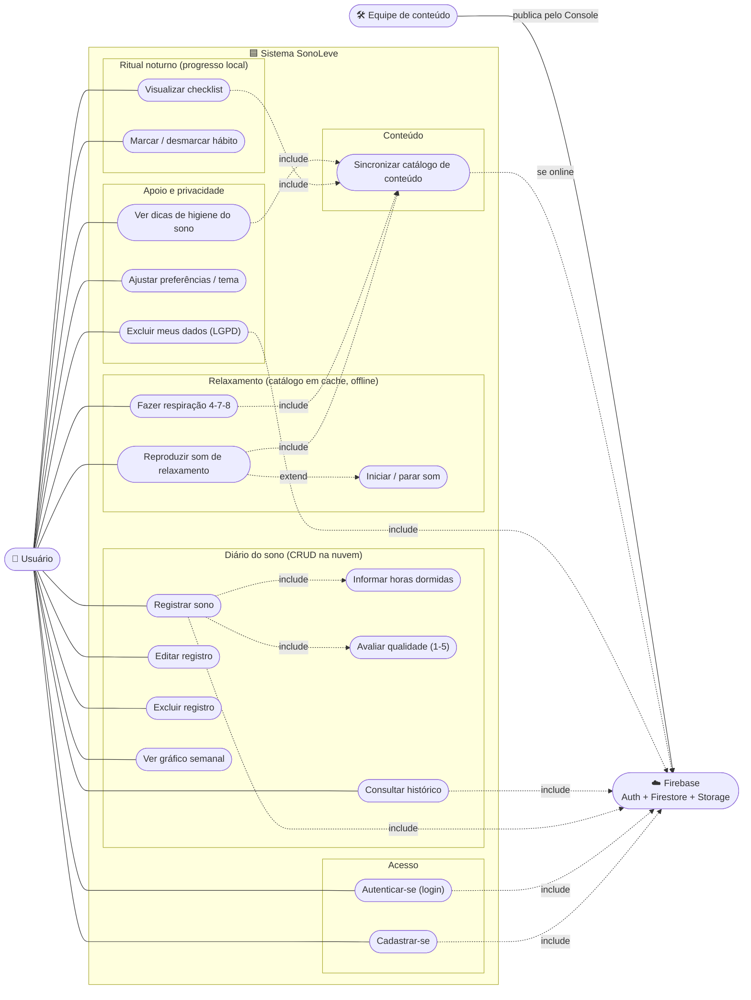

# Diagrama de Casos de Uso — SonoLeve

> Unidade II — Diagrama de Casos de Uso atualizado com as novas regras de
> negócio. Representa as interações entre o usuário e o sistema, considerando a
> autenticação e a persistência no Firebase.

**Ator principal:** Usuário (persona Jennifer Lopes).
**Atores secundários:**
- **Firebase** (Authentication + Cloud Firestore + Storage): apoia a autenticação, a
  persistência do diário do sono e a entrega do catálogo de conteúdo.
- **Equipe de conteúdo**: publica sons, dicas, hábitos e técnicas de respiração pelo Console
  do Firebase, sem passar pelo app e sem exigir nova versão dele.

> O progresso do **checklist** (UC4) é gravado só no dispositivo; os casos de uso que exibem
> conteúdo (UC3, UC5, UC7, UC15) leem o catálogo a partir do cache local (UC18).

---

## 1. Diagrama

> Legenda: linhas sólidas = associação ator↔caso de uso; `include` = o caso de uso sempre
> aciona o outro; `extend` = comportamento opcional/condicional.

---

## 2. Rastreabilidade (caso de uso → requisito)

| # | Caso de uso | Requisitos / Funcionalidades | Persistência |
|---|---|---|---|
| UC1 | Cadastrar-se | Autenticação (Firebase Auth) | Firebase Auth |
| UC2 | Autenticar-se (login) | Autenticação (Firebase Auth) | Firebase Auth |
| UC3 | Visualizar checklist | F01, RF01 | catálogo (cache) |
| UC4 | Marcar / desmarcar hábito | F01, RF02 | **local** (dispositivo) |
| UC5 | Reproduzir som de relaxamento | F03, RF04, RNF04 | catálogo + áudio baixado |
| UC6 | Iniciar / parar som | RF05 | — |
| UC7 | Fazer respiração 4-7-8 | F02, RF03, RNF04 | catálogo (cache) |
| UC8 | Registrar sono | F04, RF06, RF07 | Firestore |
| UC9 | Informar horas dormidas | RF06 | Firestore |
| UC10 | Avaliar qualidade (1-5) | RF07 | Firestore |
| UC11 | Consultar histórico | F05, RF08 | Firestore |
| UC12 | Editar registro | RF09 | Firestore |
| UC13 | Excluir registro | RF10 | Firestore |
| UC14 | Ver gráfico semanal | F06, RF11 | Firestore |
| UC15 | Ver dicas de higiene do sono | F07, RF12 | catálogo (cache) |
| UC16 | Ajustar preferências / tema | F08, RF13, RNF03 | Firestore |
| UC17 | Excluir meus dados (LGPD) | RNF08, RNF09 | Firestore + local |
| UC18 | Sincronizar catálogo de conteúdo | RNF04, RNF10 | Firestore + Storage → cache |

---

## 3. Especificação dos casos de uso centrais

### UC2 — Autenticar-se (login)
- **Ator:** Usuário · **Pré-condição:** possuir conta.
- **Fluxo principal:** informar e-mail e senha → sistema valida no Firebase Auth → acessa a
  tela Hoje.
- **Fluxos de exceção:** credenciais inválidas ou sem conexão → exibir mensagem clara e
  permanecer na tela de login.

### UC4 — Marcar / desmarcar hábito
- **Ator:** Usuário · **Pré-condição:** estar na tela do ritual noturno.
- **Fluxo principal:** tocar em um hábito → sistema alterna seu estado → atualiza o progresso
  (ex.: 2 de 4) → grava a lista de IDs concluídos no **armazenamento local** do dia.
- **Observação:** não acessa o Firebase; funciona totalmente offline.

### UC8 — Registrar sono *(include UC9, UC10)*
- **Ator:** Usuário · **Pré-condição:** estar autenticado.
- **Fluxo principal:** abrir "Novo registro" → **informar horas dormidas (UC9)** → **avaliar
  qualidade de 1 a 5 (UC10)** → (observação opcional) → salvar.
- **Regras de negócio:** horas entre 0 e 24 (RN02); qualidade inteira de 1 a 5 (RN01); no
  máximo um registro por dia (RN03).
- **Fluxo de exceção:** dados inválidos → destacar o campo e bloquear o salvamento.

### UC13 — Excluir registro
- **Ator:** Usuário · **Pré-condição:** existir o registro.
- **Fluxo principal:** abrir o registro → excluir → confirmar → sistema remove do Firestore.

### UC17 — Excluir meus dados (LGPD)
- **Ator:** Usuário · **Pré-condição:** estar autenticado.
- **Fluxo principal:** Configurações → "Excluir meus dados" → confirmar → sistema apaga toda
  a árvore `usuarios/{uid}` (RNF09) e limpa o progresso local do checklist.

### UC18 — Sincronizar catálogo de conteúdo
- **Ator:** sistema, ao abrir o app (em segundo plano).
- **Fluxo principal:** exibir o catálogo do cache → se houver conexão, ler
  `config/catalogo.versao` → se for maior que a versão local, baixar os itens ativos e os
  áudios novos ou alterados → salvar a nova versão local (RN09).
- **Fluxos alternativos:** sem conexão → seguir com o cache; primeiro uso sem internet →
  usar o conteúdo embarcado no app.
- **Regra de negócio:** o catálogo é somente leitura no app (RN08).

---

### Documentos relacionados
- `modelo-dominio.md` — entidades que suportam os casos de uso
- `modelagem-banco-dados.md` — regras de negócio (RN01–RN09) e persistência
- `fluxo-navegacao.md` — como os casos de uso se traduzem em navegação entre telas
