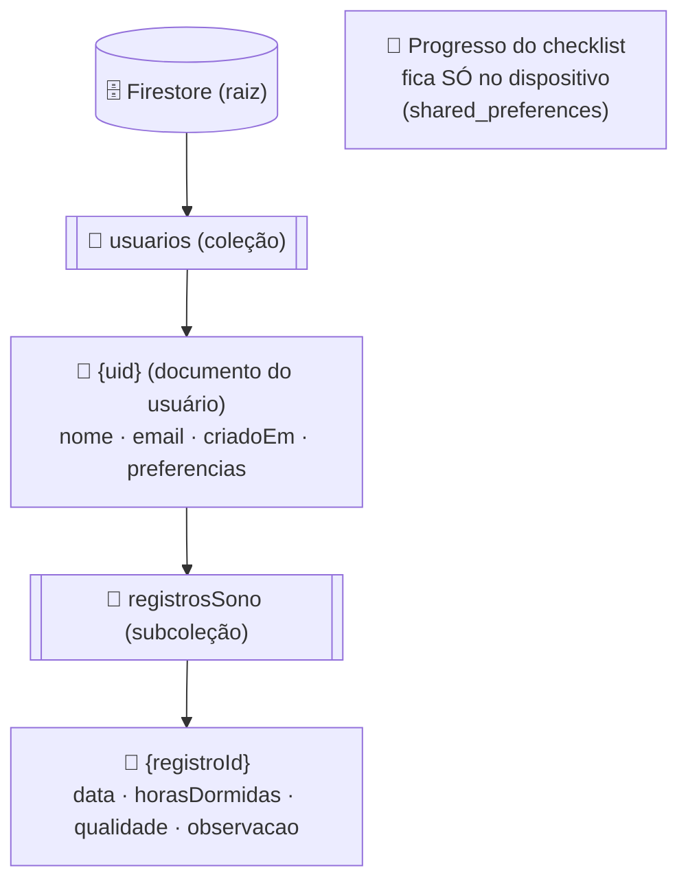
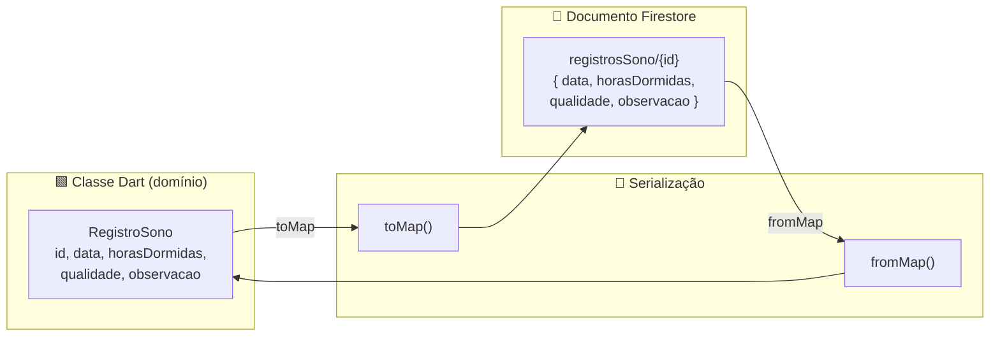

# Modelagem do Banco de Dados (Cloud Firestore) — SonoLeve

> Unidade II · Itens **b.iii)** e **b.iv)**
> b.iii — Estrutura de coleções e documentos no Firebase.
> b.iv — Como as classes de domínio do Dart se mapeiam para o Firestore.

O SonoLeve usa **Cloud Firestore** (banco NoSQL de documentos). Todos os dados pessoais
ficam **sob o documento do usuário**, usando o `uid` do Firebase Authentication como chave.
Esse desenho simplifica as regras de segurança (LGPD/RNF08) e a exclusão de dados (RNF09).

---

## 1. Estrutura de coleções e documentos



Caminho completo das coleções:

```
usuarios/{uid}
usuarios/{uid}/registrosSono/{registroId}
```

> **O checklist diário não fica no Firestore.** O catálogo de hábitos é estático e global
> (asset do app) e o progresso de cada dia é gravado **apenas no dispositivo**
> (`shared_preferences`), atendendo à privacidade (RNF08) e ao uso offline (RNF04/RNF07)
> sem custo de nuvem.

> **Por que subcoleções sob o usuário?**
> 1. **Privacidade** — fica trivial garantir, via *security rules*, que ninguém acesse
>    dados de outro usuário.
> 2. **Exclusão (RNF09)** — "excluir meus dados" = apagar a árvore de `usuarios/{uid}`.
> 3. **Consultas simples** — histórico e gráfico semanal filtram apenas dentro do próprio
>    usuário, sem precisar de índices compostos complexos.

---

## 2. Documento `usuarios/{uid}`

| Campo | Tipo Firestore | Tipo Dart | Obrigatório | Observações |
|---|---|---|---|---|
| `nome` | string | String | sim | nome de exibição |
| `email` | string | String | sim | espelha o e-mail do Auth |
| `criadoEm` | timestamp | DateTime | sim | data de cadastro |
| `preferencias` | map | PreferenciasUsuario | sim | objeto aninhado (ver abaixo) |

**Mapa `preferencias` (objeto aninhado):**

| Campo | Tipo | Dart | Padrão |
|---|---|---|---|
| `modoEscuro` | bool | bool | `true` (RNF03) |
| `temaAutomatico` | bool | bool | `true` |
| `horaInicioNoite` | string | String | `"21:00"` |
| `horaFimNoite` | string | String | `"06:00"` |

Exemplo de documento:

```json
{
  "nome": "Jennifer Lopes",
  "email": "jennifer@email.com",
  "criadoEm": "2026-11-03T21:40:00Z",
  "preferencias": {
    "modoEscuro": true,
    "temaAutomatico": true,
    "horaInicioNoite": "21:00",
    "horaFimNoite": "06:00"
  }
}
```

---

## 3. Documento `registrosSono/{registroId}`

Entidade central do CRUD (ver `crud.md`). Atende RF06–RF10.

| Campo | Tipo Firestore | Tipo Dart | Obrigatório | Regra de negócio |
|---|---|---|---|---|
| `data` | timestamp | DateTime | sim | noite de referência; **1 registro por dia** |
| `horasDormidas` | number | double | sim | `0 < horasDormidas <= 24` |
| `qualidade` | number | int | sim | inteiro de **1 a 5** |
| `observacao` | string | String | não | opcional, ≤ 280 caracteres |
| `criadoEm` | timestamp | DateTime | sim | preenchido na criação |
| `atualizadoEm` | timestamp | DateTime | sim | atualizado a cada edição |

Exemplo:

```json
{
  "data": "2026-11-02T00:00:00Z",
  "horasDormidas": 6.5,
  "qualidade": 4,
  "observacao": "Demorei para dormir, mas acordei bem.",
  "criadoEm": "2026-11-03T07:10:00Z",
  "atualizadoEm": "2026-11-03T07:10:00Z"
}
```

---

## 4. Checklist diário — armazenamento **local** (fora do Firestore)

O ritual noturno (F01, RF01/RF02) tem duas partes com naturezas diferentes:

- **Catálogo de hábitos — estático e global.** A lista de hábitos ("Reduzir a luz do
  ambiente", "Silenciar as notificações", "Preparar um lugar tranquilo", "Reservar um tempo
  para mim") é **igual para todos os usuários** e é **empacotada como asset/constante** no
  app. Não vai ao banco.
- **Progresso do dia — individual e local.** Quais hábitos o usuário marcou em uma data é
  gravado **apenas no dispositivo**, via `shared_preferences`. Reseta por dia e **não**
  sincroniza com a nuvem.

Formato sugerido no `shared_preferences` (chave = data):

```
chave:  "checklist_2026-11-03"
valor:  ["luz", "notificacoes"]          // apenas os IDs dos hábitos concluídos
```

O título de cada hábito vem do catálogo estático — por isso só os **IDs** precisam ser
guardados. Não há documento, coleção nem *security rule* associados a este dado.

> **Motivação da decisão:** o checklist é um apoio de rotina de curto prazo; mantê-lo local
> é mais simples, totalmente offline, privado por padrão e sem custo de leitura/escrita no
> Firestore. Caso, no futuro, o grupo queira histórico/evolução entre aparelhos, basta
> promovê-lo a uma subcoleção `usuarios/{uid}/checklistDiario/{YYYY-MM-DD}` guardando apenas
> a lista de IDs concluídos.

---

## 5. Mapeamento classe Dart → documento Firestore (b.iv)

A conversão é feita pelos métodos `toMap()` (gravar) e `fromMap()` (ler) de cada modelo.



Tabela de correspondência de tipos:

| Domínio (Dart) | Firestore | Conversão |
|---|---|---|
| `String` | string | direta |
| `int` / `double` | number | direta |
| `bool` | boolean | direta |
| `DateTime` | timestamp | `Timestamp.fromDate()` ↔ `.toDate()` |
| objeto (`PreferenciasUsuario`) | map | `toMap()` aninhado |
| lista (`List<ItemHabito>`) | array<map> | `map((h) => h.toMap())` |
| `id` do objeto | **ID do documento** | não é campo interno; vem de `doc.id` |

Exemplo de serialização (`RegistroSono`):

```dart
Map<String, dynamic> toMap() => {
  'data': Timestamp.fromDate(data),
  'horasDormidas': horasDormidas,
  'qualidade': qualidade,
  'observacao': observacao,
  'criadoEm': Timestamp.fromDate(criadoEm),
  'atualizadoEm': Timestamp.fromDate(atualizadoEm),
};

factory RegistroSono.fromMap(String id, Map<String, dynamic> map) => RegistroSono(
  id: id,
  data: (map['data'] as Timestamp).toDate(),
  horasDormidas: (map['horasDormidas'] as num).toDouble(),
  qualidade: map['qualidade'] as int,
  observacao: map['observacao'] as String? ?? '',
  criadoEm: (map['criadoEm'] as Timestamp).toDate(),
  atualizadoEm: (map['atualizadoEm'] as Timestamp).toDate(),
);
```

> Observação: o atributo `id` da classe **não** é gravado como campo; ele corresponde ao
> **ID do documento** (`doc.id`). Por isso `fromMap()` recebe o `id` separadamente.

---

## 6. Operações (CRUD) mapeadas para o Firestore

| Operação de negócio | RF | Chamada Firestore |
|---|---|---|
| Criar registro | RF06, RF07 | `usuarios/{uid}/registrosSono.add(obj.toMap())` |
| Consultar histórico | RF08 | `registrosSono.orderBy('data', descending: true).get()` |
| Gráfico semanal | RF11 | `registrosSono.where('data', isGreaterThanOrEqualTo: inicioSemana).get()` |
| Editar registro | RF09 | `registrosSono.doc(id).update(obj.toMap())` |
| Excluir registro | RF10 | `registrosSono.doc(id).delete()` |
| Marcar hábito | RF01, RF02 | **local** — `prefs.setStringList('checklist_YYYY-MM-DD', ids)` |
| Excluir todos os dados | RNF09 | apagar documentos sob `usuarios/{uid}` |

---

## 7. Regras de negócio e validação

Aplicadas na camada de domínio (`RegistroSono.valido()`) **e** reforçadas nas *security
rules*:

- **RN01** — `qualidade` deve ser inteiro entre **1 e 5**.
- **RN02** — `horasDormidas` deve ser **> 0 e ≤ 24**.
- **RN03** — no máximo **um registro de sono por data** (chave lógica = dia).
- **RN04** — `observacao` é opcional, limitada a **280 caracteres**.
- **RN05** — um usuário só pode ler/gravar dados sob o **próprio `uid`**.
- **RN06** — ao excluir a conta, **todos** os dados do usuário são removidos (RNF09).
- **RN07** — o progresso do checklist é **local ao dispositivo** e identificado pela **data**
  (um por dia); o catálogo de hábitos é estático e global, não armazenado no banco.

---

## 8. Regras de segurança (Firestore Security Rules)

```
rules_version = '2';
service cloud.firestore {
  match /databases/{database}/documents {

    // Cada usuário só acessa o próprio documento e subcoleções (RN05 / RNF08)
    match /usuarios/{uid} {
      allow read, write: if request.auth != null && request.auth.uid == uid;

      match /registrosSono/{registroId} {
        allow read, delete: if request.auth != null && request.auth.uid == uid;
        allow create, update: if request.auth != null
          && request.auth.uid == uid
          && request.resource.data.qualidade is int
          && request.resource.data.qualidade >= 1
          && request.resource.data.qualidade <= 5
          && request.resource.data.horasDormidas > 0
          && request.resource.data.horasDormidas <= 24;
      }

    }
  }
}
```

---

## 9. Índices e desempenho

- As consultas de histórico e do gráfico semanal usam apenas `orderBy`/`where` sobre o
  campo `data` dentro da subcoleção do usuário — o Firestore cria o **índice simples**
  automaticamente, sem necessidade de índice composto.
- A persistência offline (`persistenceEnabled = true`) serve as leituras a partir do cache,
  reduzindo chamadas de rede e consumo de bateria (RNF10).

---

### Documentos relacionados
- `arquitetura.md` — camadas e integração Firebase
- `modelo-dominio.md` — classes de domínio que originam estes documentos
- `crud.md` — descrição funcional do CRUD de registros de sono
