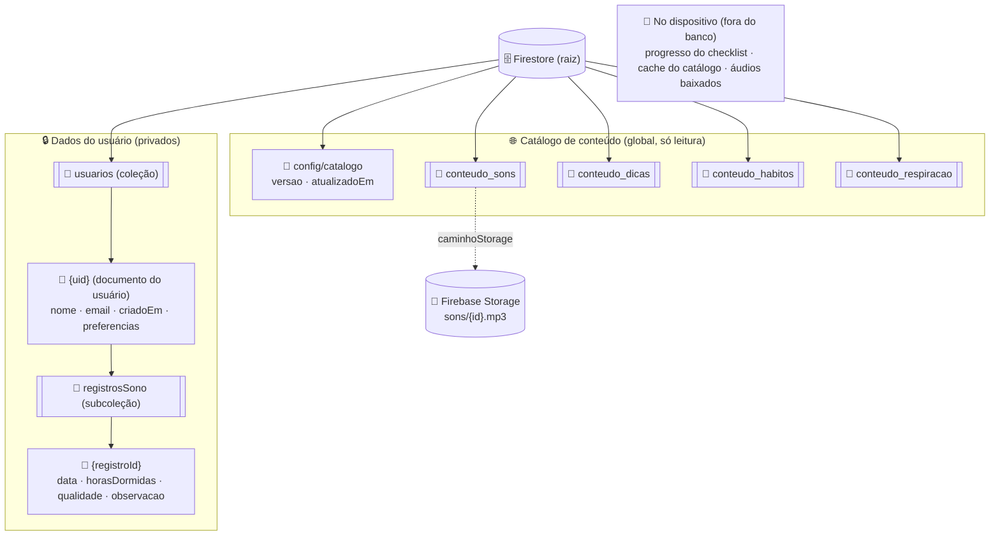
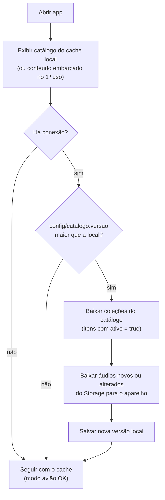
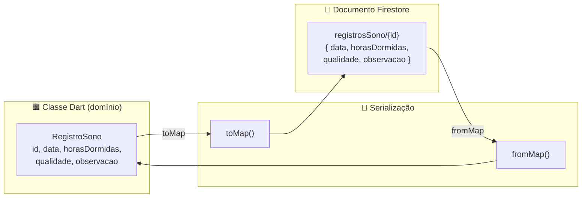

# Modelagem do Banco de Dados (Cloud Firestore) — SonoLeve

> Unidade II · Itens **b.iii)** e **b.iv)**
> b.iii — Estrutura de coleções e documentos no Firebase.
> b.iv — Como as classes de domínio do Dart se mapeiam para o Firestore.
> DER relacional equivalente: `der.dbml` (dbdiagram.io).

O SonoLeve usa **Cloud Firestore** (banco NoSQL de documentos) e **Firebase Storage**
(arquivos de áudio). Os dados se dividem em dois grupos com naturezas opostas:

| Grupo | O que é | Quem escreve | Escopo |
|---|---|---|---|
| **Dados do usuário** | perfil, preferências e diário do sono | o próprio usuário, pelo app | privado, sob `usuarios/{uid}` |
| **Catálogo de conteúdo** | sons, dicas, hábitos do checklist, técnicas de respiração | a equipe, pelo Console do Firebase | global, igual para todos, só leitura no app |

Todos os dados pessoais ficam **sob o documento do usuário**, usando o `uid` do Firebase
Authentication como chave. Esse desenho simplifica as regras de segurança (LGPD/RNF08) e a
exclusão de dados (RNF09). Já o catálogo fica no banco para que a equipe possa **trocar,
incluir ou desativar conteúdo sem publicar uma nova versão do app**; o cache local mantém
tudo funcionando offline (RNF04).

---

## 1. Estrutura de coleções e documentos



Caminho completo das coleções:

```
# dados do usuário
usuarios/{uid}
usuarios/{uid}/registrosSono/{registroId}

# catálogo global
config/catalogo
conteudo_sons/{somId}
conteudo_dicas/{dicaId}
conteudo_habitos/{habitoId}
conteudo_respiracao/{tecnicaId}

# Firebase Storage
sons/{somId}.mp3
```

> **O progresso do checklist não fica no Firestore.** A lista de hábitos vem do catálogo
> (`conteudo_habitos`), mas o que cada usuário marca em cada dia é gravado **apenas no
> dispositivo** (`shared_preferences`), atendendo à privacidade (RNF08) e ao uso offline
> (RNF04/RNF07) sem custo de nuvem.

> **Por que subcoleções sob o usuário?**
> 1. **Privacidade** — fica trivial garantir, via *security rules*, que ninguém acesse
>    dados de outro usuário.
> 2. **Exclusão (RNF09)** — "excluir meus dados" = apagar a árvore de `usuarios/{uid}`.
> 3. **Consultas simples** — histórico e gráfico semanal filtram apenas dentro do próprio
>    usuário, sem precisar de índices compostos complexos.

> **Por que o catálogo fica em coleções de nível raiz?** Ele é igual para todos. Guardar
> uma cópia por usuário desperdiçaria leituras e armazenamento.

---

## 2. Documento `usuarios/{uid}`

| Campo | Tipo Firestore | Tipo Dart | Obrigatório | Observações |
|---|---|---|---|---|
| `nome` | string | String | sim | nome de exibição |
| `email` | string | String | sim | espelha o e-mail do Auth |
| `criadoEm` | timestamp | DateTime | sim | data de cadastro |
| `preferencias` | map | PreferenciasUsuario | sim | objeto aninhado (ver abaixo) |

**Mapa `preferencias` (objeto aninhado):**

| Campo | Tipo | Dart | Padrão |
|---|---|---|---|
| `modoEscuro` | bool | bool | `true` (RNF03) |
| `temaAutomatico` | bool | bool | `true` |
| `horaInicioNoite` | string | String | `"21:00"` |
| `horaFimNoite` | string | String | `"06:00"` |

Exemplo de documento:

```json
{
  "nome": "Jennifer Lopes",
  "email": "jennifer@email.com",
  "criadoEm": "2026-11-03T21:40:00Z",
  "preferencias": {
    "modoEscuro": true,
    "temaAutomatico": true,
    "horaInicioNoite": "21:00",
    "horaFimNoite": "06:00"
  }
}
```

---

## 3. Documento `registrosSono/{registroId}`

Entidade central do CRUD (ver `crud.md`). Atende RF06–RF10.

| Campo | Tipo Firestore | Tipo Dart | Obrigatório | Regra de negócio |
|---|---|---|---|---|
| `data` | timestamp | DateTime | sim | noite de referência; **1 registro por dia** |
| `horasDormidas` | number | double | sim | `0 < horasDormidas <= 24` |
| `qualidade` | number | int | sim | inteiro de **1 a 5** |
| `observacao` | string | String | não | opcional, ≤ 280 caracteres |
| `criadoEm` | timestamp | DateTime | sim | preenchido na criação |
| `atualizadoEm` | timestamp | DateTime | sim | atualizado a cada edição |

Exemplo:

```json
{
  "data": "2026-11-02T00:00:00Z",
  "horasDormidas": 6.5,
  "qualidade": 4,
  "observacao": "Demorei para dormir, mas acordei bem.",
  "criadoEm": "2026-11-03T07:10:00Z",
  "atualizadoEm": "2026-11-03T07:10:00Z"
}
```

---

## 4. Catálogo de conteúdo (global)

Todas as coleções do catálogo compartilham três campos de controle:

| Campo | Tipo | Função |
|---|---|---|
| `ordem` | number | posição de exibição na tela |
| `ativo` | bool | `false` oculta o item no app sem apagá-lo |
| `atualizadoEm` | timestamp | data da última alteração |

### 4.1 `config/catalogo`

Documento único que diz ao app se algo mudou.

| Campo | Tipo | Dart | Observações |
|---|---|---|---|
| `versao` | number | int | a equipe incrementa a cada alteração no catálogo |
| `atualizadoEm` | timestamp | DateTime | data da última publicação |

### 4.2 `conteudo_sons/{somId}`

| Campo | Tipo | Dart | Observações |
|---|---|---|---|
| `nome` | string | String | ex.: "Chuva suave" |
| `descricao` | string | String | ex.: "Gotas que desaceleram" |
| `icone` | string | String | nome do ícone na UI |
| `caminhoStorage` | string | String | ex.: `sons/chuva_suave.mp3` |
| `duracaoSeg` | number | int | duração do trecho em *loop* |
| `tamanhoBytes` | number | int | permite avisar antes de baixar |
| `ordem`, `ativo`, `atualizadoEm` | — | — | campos de controle |

```json
{
  "nome": "Chuva suave",
  "descricao": "Gotas que desaceleram",
  "icone": "rain",
  "caminhoStorage": "sons/chuva_suave.mp3",
  "duracaoSeg": 120,
  "tamanhoBytes": 950000,
  "ordem": 1,
  "ativo": true,
  "atualizadoEm": "2026-11-10T18:00:00Z"
}
```

> O áudio **não** fica no Firestore: um documento tem limite de 1 MB e o banco não é feito
> para arquivos binários. Por isso o arquivo vai para o **Firebase Storage** e o documento
> guarda apenas o caminho.

### 4.3 `conteudo_dicas/{dicaId}`

| Campo | Tipo | Dart |
|---|---|---|
| `titulo` | string | String |
| `conteudo` | string | String |
| `ordem`, `ativo`, `atualizadoEm` | — | — |

### 4.4 `conteudo_habitos/{habitoId}`

Itens do checklist noturno (F01). Exemplos de IDs: `luz`, `notificacoes`, `lugar`, `tempo`.

| Campo | Tipo | Dart | Exemplo |
|---|---|---|---|
| `titulo` | string | String | "Reduzir a luz do ambiente" |
| `descricao` | string | String | texto de apoio opcional |
| `ordem`, `ativo`, `atualizadoEm` | — | — | — |

### 4.5 `conteudo_respiracao/{tecnicaId}`

| Campo | Tipo | Dart | 4-7-8 |
|---|---|---|---|
| `nome` | string | String | "Respiração 4-7-8" |
| `inspirarSeg` | number | int | 4 |
| `segurarSeg` | number | int | 7 |
| `expirarSeg` | number | int | 8 |
| `ciclos` | number | int | 4 |
| `ativo`, `atualizadoEm` | — | — | — |

---

## 5. Sincronização do catálogo e funcionamento offline

O catálogo segue a ordem **cache primeiro, rede depois**: o usuário nunca espera a rede
para ver os sons, e o app nunca fica sem conteúdo.



| Camada de cache | O que guarda | Onde |
|---|---|---|
| **Conteúdo embarcado (seed)** | versão mínima do catálogo: 3 sons, respiração 4-7-8, 4 hábitos, dicas básicas | assets do app |
| **Cache do Firestore** | documentos do catálogo já lidos | persistência offline do Firestore |
| **Áudios baixados** | arquivos `.mp3` do Storage | pasta do app (`path_provider`) |
| **Versão local** | último `versao` sincronizado | `shared_preferences` |

Consequências práticas:

- **Trocar um som ou uma dica** = editar o documento no Console, subir o arquivo (se for
  áudio) e incrementar `config/catalogo.versao`. Na próxima abertura online, todos os
  aparelhos se atualizam.
- **Remover um item** = marcar `ativo: false`. O app deixa de exibi-lo sem quebrar
  referências antigas, como um hábito já marcado no checklist do dia.
- **Áudio ainda não baixado e sem internet** = o item aparece como "disponível quando
  conectado"; os sons já baixados (ou embarcados) continuam tocando.
- A sincronização roda **em segundo plano e só quando a versão muda**, economizando rede
  e bateria (RNF10).

---

## 6. Checklist diário — progresso **local** (fora do Firestore)

O ritual noturno (F01, RF01/RF02) tem duas partes com naturezas diferentes:

- **Catálogo de hábitos — global.** A lista de hábitos ("Reduzir a luz do ambiente",
  "Silenciar as notificações", "Preparar um lugar tranquilo", "Reservar um tempo para mim")
  é **igual para todos os usuários** e vem de `conteudo_habitos` (seção 4.4).
- **Progresso do dia — individual e local.** Quais hábitos o usuário marcou em uma data é
  gravado **apenas no dispositivo**, via `shared_preferences`. Reseta por dia e **não**
  sincroniza com a nuvem.

Formato sugerido no `shared_preferences` (chave = data):

```
chave:  "checklist_2026-11-03"
valor:  ["luz", "notificacoes"]          // apenas os IDs dos hábitos concluídos
```

O título de cada hábito vem do catálogo — por isso só os **IDs** precisam ser guardados.
Se um hábito for desativado no catálogo, o ID antigo é ignorado no cálculo do progresso.
Não há documento, coleção nem *security rule* associados a este progresso.

> **Motivação da decisão:** o checklist é um apoio de rotina de curto prazo; mantê-lo local
> é mais simples, totalmente offline, privado por padrão e sem custo de leitura/escrita no
> Firestore. Caso, no futuro, o grupo queira histórico/evolução entre aparelhos, basta
> promovê-lo a uma subcoleção `usuarios/{uid}/checklistDiario/{YYYY-MM-DD}` guardando apenas
> a lista de IDs concluídos.

---

## 7. Mapeamento classe Dart → documento Firestore (b.iv)

A conversão é feita pelos métodos `toMap()` (gravar) e `fromMap()` (ler) de cada modelo.
As classes do catálogo só precisam de `fromMap()`, porque o app não escreve nelas.



Tabela de correspondência de tipos:

| Domínio (Dart) | Firestore | Conversão |
|---|---|---|
| `String` | string | direta |
| `int` / `double` | number | direta |
| `bool` | boolean | direta |
| `DateTime` | timestamp | `Timestamp.fromDate()` ↔ `.toDate()` |
| objeto (`PreferenciasUsuario`) | map | `toMap()` aninhado |
| `id` do objeto | **ID do documento** | não é campo interno; vem de `doc.id` |

Exemplo de serialização (`RegistroSono`):

```dart
Map<String, dynamic> toMap() => {
  'data': Timestamp.fromDate(data),
  'horasDormidas': horasDormidas,
  'qualidade': qualidade,
  'observacao': observacao,
  'criadoEm': Timestamp.fromDate(criadoEm),
  'atualizadoEm': Timestamp.fromDate(atualizadoEm),
};

factory RegistroSono.fromMap(String id, Map<String, dynamic> map) => RegistroSono(
  id: id,
  data: (map['data'] as Timestamp).toDate(),
  horasDormidas: (map['horasDormidas'] as num).toDouble(),
  qualidade: map['qualidade'] as int,
  observacao: map['observacao'] as String? ?? '',
  criadoEm: (map['criadoEm'] as Timestamp).toDate(),
  atualizadoEm: (map['atualizadoEm'] as Timestamp).toDate(),
);
```

> Observação: o atributo `id` da classe **não** é gravado como campo; ele corresponde ao
> **ID do documento** (`doc.id`). Por isso `fromMap()` recebe o `id` separadamente.

Exemplo de leitura do catálogo (`Som`, somente leitura):

```dart
factory Som.fromMap(String id, Map<String, dynamic> map) => Som(
  id: id,
  nome: map['nome'] as String,
  descricao: map['descricao'] as String? ?? '',
  icone: map['icone'] as String? ?? 'music',
  caminhoStorage: map['caminhoStorage'] as String,
  duracaoSeg: map['duracaoSeg'] as int? ?? 0,
  ordem: map['ordem'] as int? ?? 0,
  ativo: map['ativo'] as bool? ?? true,
);
```

---

## 8. Operações mapeadas para o Firestore

| Operação de negócio | RF | Chamada Firestore |
|---|---|---|
| Criar registro | RF06, RF07 | `usuarios/{uid}/registrosSono.add(obj.toMap())` |
| Consultar histórico | RF08 | `registrosSono.orderBy('data', descending: true).get()` |
| Gráfico semanal | RF11 | `registrosSono.where('data', isGreaterThanOrEqualTo: inicioSemana).get()` |
| Editar registro | RF09 | `registrosSono.doc(id).update(obj.toMap())` |
| Excluir registro | RF10 | `registrosSono.doc(id).delete()` |
| Verificar versão do catálogo | — | `config/catalogo.get()` |
| Listar sons / dicas / hábitos | RF04, RF12, RF01 | `conteudo_sons.where('ativo', isEqualTo: true).orderBy('ordem').get()` (cache) |
| Baixar áudio | RF04 | **Storage** — `storage.ref(caminhoStorage).writeToFile(arquivoLocal)` |
| Marcar hábito | RF01, RF02 | **local** — `prefs.setStringList('checklist_YYYY-MM-DD', ids)` |
| Excluir todos os dados | RNF09 | apagar documentos sob `usuarios/{uid}` + limpar dados locais |

---

## 9. Regras de negócio e validação

Aplicadas na camada de domínio (`RegistroSono.valido()`) **e** reforçadas nas *security
rules*:

- **RN01** — `qualidade` deve ser inteiro entre **1 e 5**.
- **RN02** — `horasDormidas` deve ser **> 0 e ≤ 24**.
- **RN03** — no máximo **um registro de sono por data** (chave lógica = dia).
- **RN04** — `observacao` é opcional, limitada a **280 caracteres**.
- **RN05** — um usuário só pode ler/gravar dados sob o **próprio `uid`**.
- **RN06** — ao excluir a conta, **todos** os dados do usuário são removidos (RNF09).
- **RN07** — o progresso do checklist é **local ao dispositivo** e identificado pela **data**
  (um por dia); guarda apenas os IDs de `conteudo_habitos` concluídos.
- **RN08** — o catálogo de conteúdo é **somente leitura** para o app; só a equipe o altera,
  pelo Console do Firebase.
- **RN09** — o app só baixa o catálogo quando `config/catalogo.versao` é **maior** que a
  versão local, e exibe apenas itens com `ativo = true`.

---

## 10. Regras de segurança

### Firestore

```
rules_version = '2';
service cloud.firestore {
  match /databases/{database}/documents {

    // Cada usuário só acessa o próprio documento e subcoleções (RN05 / RNF08)
    match /usuarios/{uid} {
      allow read, write: if request.auth != null && request.auth.uid == uid;

      match /registrosSono/{registroId} {
        allow read, delete: if request.auth != null && request.auth.uid == uid;
        allow create, update: if request.auth != null
          && request.auth.uid == uid
          && request.resource.data.qualidade is int
          && request.resource.data.qualidade >= 1
          && request.resource.data.qualidade <= 5
          && request.resource.data.horasDormidas > 0
          && request.resource.data.horasDormidas <= 24;
      }

    }

    // Catálogo: leitura para usuários autenticados, escrita bloqueada no app (RN08)
    match /config/{doc} {
      allow read: if request.auth != null;
      allow write: if false;
    }
    match /{colecao}/{item} {
      allow read: if request.auth != null
        && colecao in ['conteudo_sons', 'conteudo_dicas',
                       'conteudo_habitos', 'conteudo_respiracao'];
      allow write: if false;
    }
  }
}
```

### Storage

```
rules_version = '2';
service firebase.storage {
  match /b/{bucket}/o {
    match /sons/{arquivo} {
      allow read: if request.auth != null;
      allow write: if false;   // upload apenas pelo Console do Firebase
    }
  }
}
```

> `allow write: if false` vale apenas para o app. O Console do Firebase e o Admin SDK ignoram
> as *security rules*, por isso a equipe continua conseguindo editar o catálogo.

---

## 11. Índices e desempenho

- As consultas de histórico e do gráfico semanal usam apenas `orderBy`/`where` sobre o
  campo `data` dentro da subcoleção do usuário — o Firestore cria o **índice simples**
  automaticamente, sem necessidade de índice composto.
- As listagens do catálogo usam `where('ativo') + orderBy('ordem')`. Na primeira execução
  o Firestore pode pedir um **índice composto**; o link para criá-lo aparece no log de erro.
- A persistência offline (`persistenceEnabled = true`) serve as leituras a partir do cache,
  reduzindo chamadas de rede e consumo de bateria (RNF10).
- O catálogo só é baixado quando a versão muda, e os áudios só quando são novos ou
  alterados. Na maioria das aberturas, o custo de rede é a leitura de um único documento
  (`config/catalogo`).

---

### Documentos relacionados
- `arquitetura.md` — camadas e integração Firebase
- `modelo-dominio.md` — classes de domínio que originam estes documentos
- `der.dbml` — DER relacional equivalente
- `crud.md` — descrição funcional do CRUD de registros de sono
