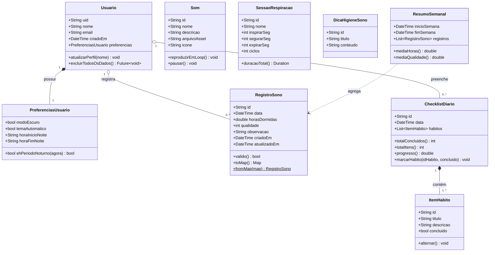

# Modelo de Domínio (Diagrama de Classes) — SonoLeve

> Unidade II · Item **b.ii)** — Representação das principais entidades do aplicativo,
> com atributos, métodos (funções) principais e relacionamentos.

Este modelo representa as classes de domínio em **Dart**. Ele é a base para a
`modelagem-banco-dados.md`, que mostra como essas classes se mapeiam para o Firestore.

---

## 1. Diagrama de classes

---

## 2. Dicionário de classes

### `Usuario` — conta autenticada
Representa o usuário autenticado via Firebase Auth. O `uid` é a chave de todos os dados.

| Atributo | Tipo | Descrição |
|---|---|---|
| `uid` | String | Identificador único (Firebase Auth) |
| `nome` | String | Nome de exibição |
| `email` | String | E-mail de login |
| `criadoEm` | DateTime | Data de criação da conta |
| `preferencias` | PreferenciasUsuario | Configurações do app |

Métodos: `atualizarPerfil()`, `excluirTodosOsDados()` (atende RNF09 / LGPD).

### `PreferenciasUsuario` — configurações
Controla o comportamento visual (RNF03, RF13). `ehPeriodoNoturno()` decide a troca de
paleta conforme o horário configurado.

### `RegistroSono` — entidade central do CRUD
É a entidade principal gerenciada pelo usuário (ver `crud.md`). Atende RF06–RF10.

| Atributo | Tipo | Descrição | Regra |
|---|---|---|---|
| `id` | String | Identificador do registro | gerado pelo Firestore |
| `data` | DateTime | Noite de referência | única por dia |
| `horasDormidas` | double | Horas dormidas | 0 < horas ≤ 24 |
| `qualidade` | int | Avaliação do sono | 1 a 5 estrelas |
| `observacao` | String | Nota opcional | ≤ 280 caracteres |
| `criadoEm` / `atualizadoEm` | DateTime | Auditoria | automático |

Método `valido()` concentra as validações (regra de negócio) antes de persistir.
`toMap()`/`fromMap()` fazem a serialização para o Firestore.

### `ChecklistDiario` e `ItemHabito` — ritual noturno
Representam o checklist de higiene do sono por dia (F01, RF01/RF02). O `ChecklistDiario`
agrupa os hábitos marcados em uma data; cada `ItemHabito` é um hábito (ex.: "Reduzir a luz
do ambiente", "Silenciar as notificações"). `progresso()` devolve a fração concluída
(ex.: 2 de 4) exibida na tela "Seu ritual".

### `Som` — conteúdo de relaxamento (catálogo estático)
Som da natureza empacotado como asset (F03, RNF04). Não pertence a um usuário; é conteúdo
fixo do app. Ex.: Chuva suave, Ondas do mar, Vento nas folhas.

### `SessaoRespiracao` — técnica guiada (catálogo estático)
Parâmetros da respiração 4-7-8 (F02): `inspirarSeg=4`, `segurarSeg=7`, `expirarSeg=8`.
Também é conteúdo estático, disponível offline.

### `DicaHigieneSono` — orientações (catálogo estático)
Dicas de higiene do sono (F07). Conteúdo fixo empacotado no app.

### `ResumoSemanal` — objeto de cálculo (não persistido)
Objeto derivado que agrega `RegistroSono` da semana para alimentar o gráfico (RF11) e o
acompanhamento semanal. É calculado em memória a partir dos registros, não é uma coleção.

---

## 3. Entidades persistidas × estáticas

| Classe | Onde vive | Motivo |
|---|---|---|
| Usuario, PreferenciasUsuario | 🔵 Firestore (`usuarios/{uid}`) | dado pessoal |
| RegistroSono | 🔵 Firestore (subcoleção) | dado do usuário, CRUD |
| ChecklistDiario, ItemHabito | 🔵 Firestore (subcoleção) | estado diário do usuário |
| Som, SessaoRespiracao, DicaHigieneSono | 📦 Assets locais | conteúdo fixo, offline |
| ResumoSemanal | 🧮 Em memória | calculado, não armazenado |

> Essa separação é o que viabiliza o offline-first: o conteúdo de relaxamento nunca
> depende de rede, e apenas os dados realmente pessoais vão para o banco.
