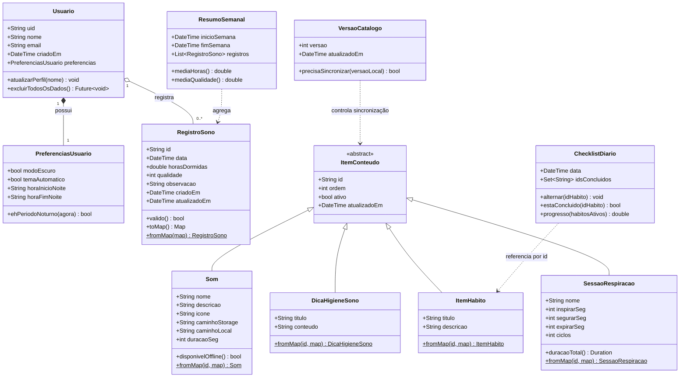

# Modelo de Domínio (Diagrama de Classes) — SonoLeve

> Unidade II · Item **b.ii)** — Representação das principais entidades do aplicativo,
> com atributos, métodos (funções) principais e relacionamentos.

Este modelo representa as classes de domínio em **Dart**. Ele é a base para a
`modelagem-banco-dados.md`, que mostra como essas classes se mapeiam para o Firestore.

As classes se dividem em três grupos:

- **Dados do usuário**: `Usuario`, `PreferenciasUsuario` e `RegistroSono`, gravados no Firestore.
- **Catálogo de conteúdo**: `Som`, `DicaHigieneSono`, `ItemHabito`, `SessaoRespiracao` e
  `VersaoCatalogo`, lidos do Firestore (áudios no Storage) e guardados em cache.
- **Estado local e cálculos**: `ChecklistDiario`, gravado no dispositivo, e `ResumoSemanal`,
  calculado em memória.

---

## 1. Diagrama de classes

---

## 2. Dicionário de classes

### `Usuario` — conta autenticada
Representa o usuário autenticado via Firebase Auth. O `uid` é a chave de todos os dados.

| Atributo | Tipo | Descrição |
|---|---|---|
| `uid` | String | Identificador único (Firebase Auth) |
| `nome` | String | Nome de exibição |
| `email` | String | E-mail de login |
| `criadoEm` | DateTime | Data de criação da conta |
| `preferencias` | PreferenciasUsuario | Configurações do app |

Métodos: `atualizarPerfil()`, `excluirTodosOsDados()` (atende RNF09 / LGPD).

### `PreferenciasUsuario` — configurações
Controla o comportamento visual (RNF03, RF13). `ehPeriodoNoturno()` decide a troca de
paleta conforme o horário configurado.

### `RegistroSono` — entidade central do CRUD
É a entidade principal gerenciada pelo usuário (ver `crud.md`). Atende RF06–RF10.

| Atributo | Tipo | Descrição | Regra |
|---|---|---|---|
| `id` | String | Identificador do registro | gerado pelo Firestore |
| `data` | DateTime | Noite de referência | única por dia |
| `horasDormidas` | double | Horas dormidas | 0 < horas ≤ 24 |
| `qualidade` | int | Avaliação do sono | 1 a 5 estrelas |
| `observacao` | String | Nota opcional | ≤ 280 caracteres |
| `criadoEm` / `atualizadoEm` | DateTime | Auditoria | automático |

Método `valido()` concentra as validações (regra de negócio) antes de persistir.
`toMap()`/`fromMap()` fazem a serialização para o Firestore.

### `ChecklistDiario` — progresso do ritual noturno (local)
Guarda o progresso do checklist de higiene do sono em uma data (F01, RF01/RF02). Armazena
**apenas os IDs** dos hábitos concluídos (`idsConcluidos`); o título de cada hábito vem de
`ItemHabito`. `progresso(habitosAtivos)` devolve a fração concluída considerando só os
hábitos ativos (ex.: 2 de 4), exibida na tela "Seu ritual". É gravado no dispositivo.

### `ItemConteudo` — base do catálogo (abstrata)
Reúne os campos de controle de todo item do catálogo: `id` (ID do documento), `ordem`
(posição de exibição), `ativo` (`false` oculta o item sem apagá-lo) e `atualizadoEm`. As
subclasses só têm `fromMap()`: o app lê o catálogo e nunca escreve nele (RN08).

### `ItemHabito` — hábito do checklist (catálogo)
Item do ritual noturno, lido de `conteudo_habitos`. Ex.: "Reduzir a luz do ambiente",
"Silenciar as notificações". É igual para todos os usuários.

### `Som` — conteúdo de relaxamento (catálogo)
Metadados em `conteudo_sons`; o arquivo de áudio fica no Firebase Storage
(`caminhoStorage`). Depois do download, `caminhoLocal` aponta para o arquivo no aparelho e
`disponivelOffline()` retorna `true` (F03, RNF04). Ex.: Chuva suave, Ondas do mar, Vento
nas folhas.

### `SessaoRespiracao` — técnica guiada (catálogo)
Parâmetros da respiração, lidos de `conteudo_respiracao`. Na 4-7-8 (F02): `inspirarSeg=4`,
`segurarSeg=7`, `expirarSeg=8`. `duracaoTotal()` calcula o tempo da sessão.

### `DicaHigieneSono` — orientações (catálogo)
Dicas de higiene do sono (F07), lidas de `conteudo_dicas`.

### `VersaoCatalogo` — controle de sincronização
Espelha `config/catalogo`. `precisaSincronizar(versaoLocal)` retorna `true` quando a versão
remota é maior que a última baixada (RN09).

### `ResumoSemanal` — objeto de cálculo (não persistido)
Objeto derivado que agrega `RegistroSono` da semana para alimentar o gráfico (RF11) e o
acompanhamento semanal. É calculado em memória a partir dos registros, não é uma coleção.

---

## 3. Onde cada classe vive

| Classe | Onde vive | Quem escreve | Motivo |
|---|---|---|---|
| Usuario, PreferenciasUsuario | 🔵 Firestore (`usuarios/{uid}`) | app (usuário) | dado pessoal |
| RegistroSono | 🔵 Firestore (subcoleção) | app (usuário) | dado do usuário, CRUD |
| Som | 🌐 Firestore (`conteudo_sons`) + 🎵 Storage + cache | equipe (Console) | conteúdo atualizável sem nova versão |
| DicaHigieneSono | 🌐 Firestore (`conteudo_dicas`) + cache | equipe (Console) | idem |
| ItemHabito | 🌐 Firestore (`conteudo_habitos`) + cache | equipe (Console) | idem |
| SessaoRespiracao | 🌐 Firestore (`conteudo_respiracao`) + cache | equipe (Console) | idem |
| VersaoCatalogo | 🌐 Firestore (`config/catalogo`) | equipe (Console) | controle de sincronização |
| ChecklistDiario | 💾 Local (`shared_preferences`) | app (usuário) | privado, reseta por dia, sem nuvem |
| ResumoSemanal | 🧮 Em memória | — | calculado, não armazenado |

> O catálogo fica no banco para que a equipe troque conteúdo sem publicar uma nova versão
> do app, e fica em cache no aparelho para continuar funcionando offline (RNF04). Os dados
> pessoais ficam isolados por usuário.
